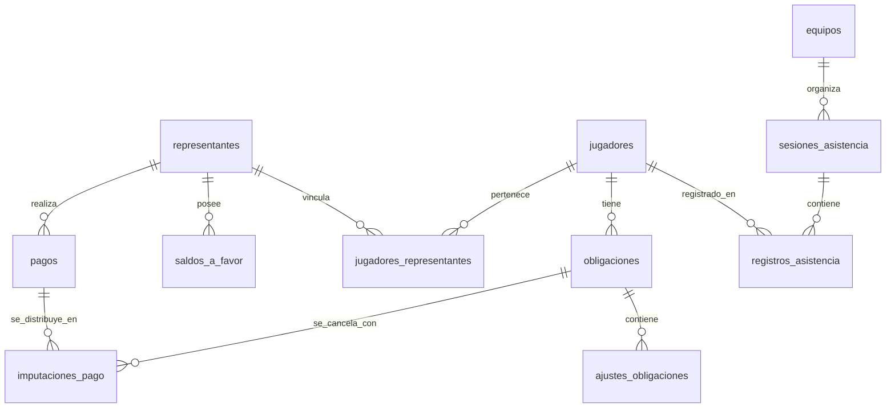

# Especificación Funcional, Modelo de Datos y Arquitectura de Referencia
## FichApp (Gestor de Academias Deportivas) — Versión 0.3

> **Estado:** Documento Maestro Definitivo para Implementación  
> **Academia Piloto:** Obelisco FC, Barquisimeto, Venezuela  
> **Producto:** Plataforma SaaS móvil-first para la administración y gestión deportiva de academias  
> **Stack Base:** React Native + Expo (Offline-First en cancha), PHP 8.5 puro (Arquitectura Service-Repository / PSR) y PostgreSQL 16+  
> **Fecha de Actualización:** Noviembre 2026  

---

## 1. Descripción del Producto y Problema

### 1.1. Propósito
**FichApp** es una plataforma SaaS diseñada para centralizar, profesionalizar y automatizar los procesos administrativos, deportivos y de recaudación de academias, clubes y escuelas deportivas en América Latina, iniciando su validación en el ecosistema bimonetario de Venezuela.

### 1.2. Problema que Resuelve
1. **Caos en la cobranza bimonetaria:** Pagos fraccionados en Bolívares (VES vía Pago Móvil/Transferencia) a tasa oficial BCV mezclados con pagos en efectivo en Dólares (USD).
2. **Pagos familiares no consolidados:** Un representante con 2 o 3 hijos transfiere un solo monto global que la administración tarda horas en conciliar en cuadernos u hojas de cálculo.
3. **Pérdida de trazabilidad en descuentos:** Dificultad para registrar quién pagó dentro de la ventana de pronto-pago (ej. antes del día 15) mediante abonos parciales acumulativos.
4. **Falta de cobertura en campo:** Entrenadores que no pueden pasar asistencia en canchas deportivas debido a mala o nula conectividad celular.
5. **Riesgo de fraude o errores manuales:** Pagos borrados por error, falta de comprobantes y ausencia de pistas de auditoría.

### 1.3. Propuesta de Valor y Principios de Diseño
* **Móvil Prioritario (*Mobile-First*):** Diseñada para su uso directo desde teléfonos Android e iOS para directores y entrenadores.
* **Integridad Financiera Inmutable:** Ningún movimiento de dinero se borra; las correcciones se realizan por reversos y notas de ajuste auditadas.
* **Aritmética Decimal Exacta:** Uso estricto de números decimales de coma fija (`NUMERIC` en SQL y `bcmath` en PHP) para evitar errores de redondeo de punto flotante IEEE 754.
* **Aislamiento Estricto por Academia (*Multi-Tenancy*):** Cada academia opera de forma hermética y aislada mediante `academia_id`.
* **Cancha *Offline-First*:** El entrenador puede operar sin conexión y sincronizar la asistencia cuando recupere la señal.

---

## 2. Actores y Matriz de Permisos (RBAC)

El sistema define 3 roles para el MVP inicial:

| Módulo / Capacidad | Superadmin Plataforma | Administrador Academia | Entrenador |
| :--- | :---: | :---: | :---: |
| **Gestión de Academias (Tenants)** | Lectura / Escritura | No visible | No visible |
| **Usuarios y Roles de su Academia** | Lectura / Escritura | Lectura / Escritura | No visible |
| **Fichas de Jugadores y Categorías** | Lectura | Lectura / Escritura | Solo lectura de sus equipos |
| **Asistencia Técnica en Cancha** | Lectura | Lectura / Escritura | Lectura / Escritura (Offline) |
| **Políticas de Cobranza y Excepciones**| No visible | Lectura / Escritura | No visible |
| **Generación de Obligaciones** | No visible | Lectura / Escritura | No visible |
| **Registro de Pagos e Imputaciones** | No visible | Lectura / Escritura | No visible |
| **Reversos Financieros y Ajustes** | No visible | Lectura / Escritura (Auditado) | No visible |
| **Reportes y Caja Diaria** | No visible | Lectura / Exportación | No visible |

---

## 3. Motor Financiero y Reglas de Negocio (RN)

### RN-01. Moneda de Referencia y Monedas de Pago
Las obligaciones mensuales se originan y tasan en **USD**. Los pagos se aceptan en **USD** (efectivo, Zelle) o **VES** (Pago Móvil, transferencias bancarias).

### RN-02. Tasa de Conversión Histórica Inmutable
Todo pago en VES se convierte a USD dividiendo el monto recibido entre la tasa BCV registrada para la fecha efectiva del pago:
$$\text{equivalente\_usd} = \frac{\text{monto\_recibido\_ves}}{\text{tasa\_ves\_por\_usd}}$$
La tasa utilizada queda fijada en el registro del pago. Modificaciones futuras o tasas posteriores **nunca alteran retroactivamente** los pagos ya asentados.

### RN-03. Desacoplamiento de Pagos e Imputaciones (Pagos Familiares)
* Un **Pago** representa un movimiento de dinero real entrante reportado por un representante con su referencia y comprobante.
* Un Pago puede generar **1 o varias Imputaciones** hacia obligaciones del mismo u otros jugadores vinculados al mismo representante (ej. cubrir las cuotas de dos hermanos con un único Pago Móvil).
* La suma de las imputaciones más el remanente a favor debe ser estrictamente igual al monto equivalente en USD del pago:
$$\text{pago.equivalente\_usd} = \sum (\text{imputacion.monto\_imputado\_usd}) + \text{saldo\_a\_favor\_generado}$$

### RN-04. Saldo a Favor (Bolsa de Crédito)
Si el monto recibido supera el monto adeudado de las obligaciones seleccionadas, el remanente se acredita automáticamente a una bolsa de `saldo_a_favor` asociada al representante. Dicho saldo puede ser imputado en obligaciones de meses posteriores.

### RN-05. Política de Mensualidad Ordinaria y Pronto-Pago
Para la academia piloto (Obelisco FC):
* **Monto ordinario base:** US$ 25.00.
* **Monto pronto-pago exigible:** US$ 20.00.
* **Ventana de pronto-pago:** Del día 1 al día 15 del mes correspondiente, inclusive (hasta las 23:59:59 hora local `America/Caracas`).

### RN-06. Condición y Cálculo del Pronto-Pago
1. El beneficio se considera ganado únicamente si la sumatoria de pagos/imputaciones confirmados dentro de la ventana (hasta el día 15) alcanza el monto de pronto-pago ($US\$ 20.00$).
2. Se permiten **abonos fraccionados**; cada abono suma al acumulado dentro de la ventana.
3. Si el acumulado al cierre del día 15 es menor a US$ 20.00, se pierde la condición: la obligación permanece en el valor ordinario ($US\$ 25.00$) y los abonos se restan de ese total.
4. Cuando se completa la meta de pronto-pago, el backend emite un registro en `ajustes_obligaciones` de tipo `descuento_pronto_pago` por la diferencia ($-US\$ 5.00$), cerrando la deuda en $US\$ 0.00$. El descuento se registra como **ajuste de pasivo**, nunca como dinero ingresado.

### RN-07. Excepciones (Becas, Tarifas Reducidas y Exoneraciones)
* **Tarifa reducida:** Autoriza un monto mensual inferior para un jugador específico. El administrador debe estipular si permite pronto-pago y el monto promocional exacto.
* **Exoneración:** Genera una obligación con monto exigible igual a cero ($0.00). Mantiene el historial deportivo sin crear ingresos ficticios.

### RN-08. Inmutabilidad y Reversión
Los pagos confirmados no se eliminan (`DELETE` prohibido por política de base de datos). Para corregir un error se ejecuta una **reversión auditable** que marca el pago como `revertido`, cancela sus imputaciones y recalcula inmediatamente el saldo de las obligaciones afectadas. Si la anulación provoca que el total pagado caiga por debajo de la meta de pronto-pago, el descuento previamente otorgado es revocado automáticamente.

### RN-09. Idempotencia Transaccional
Todo registro de pago debe enviar un encabezado o campo `clave_idempotencia` único (UUID generado por el cliente móvil). Si la app reintenta la petición por inestabilidad de red, el backend devolverá la respuesta del pago original sin duplicar el ingreso en caja.

---

## 4. Requisitos Funcionales Detallados

### Módulo: Autenticación y Multi-Tenancy (RF-01)
* **RF-01.1:** Inicio de sesión con identificador/correo y contraseña segura (hash Argon2id / Bcrypt).
* **RF-01.2:** Contexto automático: Toda petición autenticada vincula el `academia_id` de la sesión. Es imposible manipular un parámetro para consultar datos de otra academia.
* **RF-01.3:** Revocación de sesiones y tokens al desactivar una cuenta.

### Módulo: Jugadores y Representantes (RF-02)
* **RF-02.1:** Gestión completa de ficha del jugador: datos personales, médicos, fecha de nacimiento, categoría y estatus (activo/inactivo).
* **RF-02.2:** Relación N a M entre jugadores y representantes con marcación de contacto principal.
* **RF-02.3:** Búsqueda rápida por nombre, apellido, cédula, equipo o categoría.

### Módulo: Categorías, Equipos y Temporadas (RF-03)
* **RF-03.1:** Estructuración de categorías por edad y modalidad (campo, sala).
* **RF-03.2:** Creación de equipos y asignación de uno o más entrenadores por equipo.
* **RF-03.3:** Asignación de jugadores a equipos preservando el historial por temporada.

### Módulo: Asistencia Técnica en Cancha (RF-04 - *Offline-First*)
* **RF-04.1:** El entrenador puede crear sesiones de entrenamiento para sus equipos asignados.
* **RF-04.2:** El entrenador puede marcar a cada jugador como `presente`, `ausente` o `justificado`, agregando notas u observaciones.
* **RF-04.3:** **Operación 100% Offline:** La app móvil permite registrar la sesión y las asistencias sin conexión a internet, guardándolas en la base de datos local SQLite con IDs generados en el dispositivo.
* **RF-04.4:** **Sincronización Idempotente:** Al recuperar señal, la app sincroniza por lote las sesiones pendientes mediante `POST /api/v1/attendance/sync`.

### Módulo: Facturación, Pagos e Imputaciones (RF-05)
* **RF-05.1:** Generación masiva o individual de obligaciones para un período (mes). El proceso es idempotente: no duplica obligaciones existentes para el mismo concepto y período.
* **RF-05.2:** Registro de pagos en USD o VES vinculados al representante o jugador.
* **RF-05.3:** Imputación flexible: Distribución de un pago entre 1 o múltiples obligaciones pendientes de la familia.
* **RF-05.4:** Aplicación automática o manual de `saldo_a_favor` preexistente.
* **RF-05.5:** Historial y reversión auditable con motivo y usuario responsable.

### Módulo: Tasas de Cambio y Gastos (RF-06)
* **RF-06.1:** Registro de tasa oficial BCV con fecha de vigencia y fuente.
* **RF-06.2:** Registro de egresos y gastos operativos de la academia clasificados por categoría (canchas, arbitraje, balones, salarios).
* **RF-06.3:** Reportes de balance de caja, recaudación efectiva y morosidad.

---

## 5. Diseño Físico de Base de Datos (PostgreSQL 16+)

Esquema de datos normalizado con tipos nativos de alta precisión, restricciones `CHECK`, índices compuestos y UUIDs como claves primarias:

```sql
-- Extensión para generación de UUIDs
CREATE EXTENSION IF NOT EXISTS "uuid-ossp";

-- ============================================================================
-- 1. TENANTS Y SEGURIDAD
-- ============================================================================
CREATE TABLE academias (
    id UUID PRIMARY KEY DEFAULT uuid_generate_v4(),
    nombre VARCHAR(150) NOT NULL,
    rif VARCHAR(30) NULL,
    telefono VARCHAR(30) NULL,
    correo VARCHAR(150) NULL,
    estado VARCHAR(20) NOT NULL DEFAULT 'activo' CHECK (estado IN ('activo', 'suspendido', 'inactivo')),
    zona_horaria VARCHAR(50) NOT NULL DEFAULT 'America/Caracas',
    configuracion JSONB NOT NULL DEFAULT '{}'::jsonb,
    creado_en TIMESTAMPTZ NOT NULL DEFAULT CURRENT_TIMESTAMP,
    actualizado_en TIMESTAMPTZ NOT NULL DEFAULT CURRENT_TIMESTAMP
);

CREATE TABLE usuarios (
    id UUID PRIMARY KEY DEFAULT uuid_generate_v4(),
    academia_id UUID NOT NULL REFERENCES academias(id) ON DELETE RESTRICT,
    nombre VARCHAR(150) NOT NULL,
    identificador_acceso VARCHAR(100) NOT NULL,
    correo VARCHAR(150) NULL,
    telefono VARCHAR(30) NULL,
    contrasena_hash VARCHAR(255) NOT NULL,
    rol VARCHAR(30) NOT NULL CHECK (rol IN ('superadmin', 'administrador', 'entrenador')),
    estado VARCHAR(20) NOT NULL DEFAULT 'activo' CHECK (estado IN ('activo', 'inactivo')),
    creado_en TIMESTAMPTZ NOT NULL DEFAULT CURRENT_TIMESTAMP,
    actualizado_en TIMESTAMPTZ NOT NULL DEFAULT CURRENT_TIMESTAMP,
    CONSTRAINT uq_usuario_acceso_academia UNIQUE (academia_id, identificador_acceso)
);

-- ============================================================================
-- 2. JUGADORES, REPRESENTANTES Y VÍNCULOS
-- ============================================================================
CREATE TABLE jugadores (
    id UUID PRIMARY KEY DEFAULT uuid_generate_v4(),
    academia_id UUID NOT NULL REFERENCES academias(id) ON DELETE RESTRICT,
    nombres VARCHAR(100) NOT NULL,
    apellidos VARCHAR(100) NOT NULL,
    fecha_nacimiento DATE NULL,
    cedula VARCHAR(30) NULL,
    sexo CHAR(1) NULL CHECK (sexo IN ('M', 'F')),
    ficha_medica JSONB NOT NULL DEFAULT '{}'::jsonb,
    estado VARCHAR(20) NOT NULL DEFAULT 'activo' CHECK (estado IN ('activo', 'inactivo', 'retirado')),
    creado_en TIMESTAMPTZ NOT NULL DEFAULT CURRENT_TIMESTAMP,
    actualizado_en TIMESTAMPTZ NOT NULL DEFAULT CURRENT_TIMESTAMP,
    eliminado_en TIMESTAMPTZ NULL
);
CREATE INDEX idx_jugadores_busqueda ON jugadores(academia_id, apellidos, nombres);

CREATE TABLE representantes (
    id UUID PRIMARY KEY DEFAULT uuid_generate_v4(),
    academia_id UUID NOT NULL REFERENCES academias(id) ON DELETE RESTRICT,
    nombres VARCHAR(100) NOT NULL,
    apellidos VARCHAR(100) NOT NULL,
    cedula VARCHAR(30) NULL,
    telefono VARCHAR(30) NOT NULL,
    correo VARCHAR(150) NULL,
    creado_en TIMESTAMPTZ NOT NULL DEFAULT CURRENT_TIMESTAMP,
    actualizado_en TIMESTAMPTZ NOT NULL DEFAULT CURRENT_TIMESTAMP
);
CREATE INDEX idx_representantes_academia ON representantes(academia_id, cedula);

CREATE TABLE jugadores_representantes (
    id UUID PRIMARY KEY DEFAULT uuid_generate_v4(),
    academia_id UUID NOT NULL REFERENCES academias(id) ON DELETE RESTRICT,
    jugador_id UUID NOT NULL REFERENCES jugadores(id) ON DELETE RESTRICT,
    representante_id UUID NOT NULL REFERENCES representantes(id) ON DELETE RESTRICT,
    tipo_relacion VARCHAR(50) NOT NULL DEFAULT 'representante_legal',
    es_contacto_principal BOOLEAN NOT NULL DEFAULT FALSE,
    creado_en TIMESTAMPTZ NOT NULL DEFAULT CURRENT_TIMESTAMP,
    CONSTRAINT uq_jugador_rep_academia UNIQUE (academia_id, jugador_id, representante_id)
);

-- Bolsa de crédito acumulado por representante (vueltos o pagos en exceso)
CREATE TABLE saldos_a_favor (
    id UUID PRIMARY KEY DEFAULT uuid_generate_v4(),
    academia_id UUID NOT NULL REFERENCES academias(id) ON DELETE RESTRICT,
    representante_id UUID NOT NULL REFERENCES representantes(id) ON DELETE RESTRICT,
    monto_disponible_usd NUMERIC(12,2) NOT NULL DEFAULT 0.00 CHECK (monto_disponible_usd >= 0),
    actualizado_en TIMESTAMPTZ NOT NULL DEFAULT CURRENT_TIMESTAMP,
    CONSTRAINT uq_saldo_favor_rep UNIQUE (academia_id, representante_id)
);

-- ============================================================================
-- 3. ESTRUCTURA DEPORTIVA Y ASISTENCIA (OFFLINE COMPATIBLE)
-- ============================================================================
CREATE TABLE categorias (
    id UUID PRIMARY KEY DEFAULT uuid_generate_v4(),
    academia_id UUID NOT NULL REFERENCES academias(id) ON DELETE RESTRICT,
    nombre VARCHAR(100) NOT NULL,
    modalidad VARCHAR(50) NOT NULL DEFAULT 'fútbol campo',
    edad_minima SMALLINT NULL,
    edad_maxima SMALLINT NULL,
    estado VARCHAR(20) NOT NULL DEFAULT 'activo',
    creado_en TIMESTAMPTZ NOT NULL DEFAULT CURRENT_TIMESTAMP
);

CREATE TABLE equipos (
    id UUID PRIMARY KEY DEFAULT uuid_generate_v4(),
    academia_id UUID NOT NULL REFERENCES academias(id) ON DELETE RESTRICT,
    categoria_id UUID NOT NULL REFERENCES categorias(id) ON DELETE RESTRICT,
    nombre VARCHAR(100) NOT NULL,
    estado VARCHAR(20) NOT NULL DEFAULT 'activo',
    creado_en TIMESTAMPTZ NOT NULL DEFAULT CURRENT_TIMESTAMP
);

CREATE TABLE asignaciones_jugadores_equipos (
    id UUID PRIMARY KEY DEFAULT uuid_generate_v4(),
    academia_id UUID NOT NULL REFERENCES academias(id) ON DELETE RESTRICT,
    jugador_id UUID NOT NULL REFERENCES jugadores(id) ON DELETE RESTRICT,
    equipo_id UUID NOT NULL REFERENCES equipos(id) ON DELETE RESTRICT,
    temporada VARCHAR(50) NOT NULL DEFAULT '2026',
    vigente_desde DATE NOT NULL DEFAULT CURRENT_DATE,
    vigente_hasta DATE NULL,
    creado_en TIMESTAMPTZ NOT NULL DEFAULT CURRENT_TIMESTAMP
);

CREATE TABLE asignaciones_entrenadores_equipos (
    id UUID PRIMARY KEY DEFAULT uuid_generate_v4(),
    academia_id UUID NOT NULL REFERENCES academias(id) ON DELETE RESTRICT,
    entrenador_id UUID NOT NULL REFERENCES usuarios(id) ON DELETE RESTRICT,
    equipo_id UUID NOT NULL REFERENCES equipos(id) ON DELETE RESTRICT,
    vigente_desde DATE NOT NULL DEFAULT CURRENT_DATE,
    vigente_hasta DATE NULL,
    creado_en TIMESTAMPTZ NOT NULL DEFAULT CURRENT_TIMESTAMP
);

CREATE TABLE sesiones_asistencia (
    id UUID PRIMARY KEY, -- Generado en el dispositivo móvil (UUID v4 o v7)
    academia_id UUID NOT NULL REFERENCES academias(id) ON DELETE RESTRICT,
    equipo_id UUID NOT NULL REFERENCES equipos(id) ON DELETE RESTRICT,
    fecha_sesion TIMESTAMPTZ NOT NULL,
    lugar VARCHAR(150) NULL,
    observaciones TEXT NULL,
    creado_por UUID NOT NULL REFERENCES usuarios(id),
    sincronizado_en TIMESTAMPTZ NOT NULL DEFAULT CURRENT_TIMESTAMP
);
CREATE INDEX idx_sesiones_equipo_fecha ON sesiones_asistencia(academia_id, equipo_id, fecha_sesion DESC);

CREATE TABLE registros_asistencia (
    id UUID PRIMARY KEY, -- Generado en el dispositivo móvil (UUID v4 o v7)
    academia_id UUID NOT NULL REFERENCES academias(id) ON DELETE RESTRICT,
    sesion_id UUID NOT NULL REFERENCES sesiones_asistencia(id) ON DELETE CASCADE,
    jugador_id UUID NOT NULL REFERENCES jugadores(id) ON DELETE RESTRICT,
    estado_asistencia VARCHAR(20) NOT NULL CHECK (estado_asistencia IN ('presente', 'ausente', 'justificado')),
    observaciones TEXT NULL,
    creado_en TIMESTAMPTZ NOT NULL DEFAULT CURRENT_TIMESTAMP,
    CONSTRAINT uq_asistencia_jugador_sesion UNIQUE (sesion_id, jugador_id)
);

-- ============================================================================
-- 4. POLÍTICAS DE COBRANZA Y OBLIGACIONES
-- ============================================================================
CREATE TABLE politicas_cobranza (
    id UUID PRIMARY KEY DEFAULT uuid_generate_v4(),
    academia_id UUID NOT NULL REFERENCES academias(id) ON DELETE RESTRICT,
    monto_ordinario_usd NUMERIC(12,2) NOT NULL DEFAULT 25.00,
    monto_pronto_pago_usd NUMERIC(12,2) NOT NULL DEFAULT 20.00,
    dia_limite_pronto_pago SMALLINT NOT NULL DEFAULT 15,
    dia_vencimiento_ordinario SMALLINT NOT NULL DEFAULT 28,
    vigente_desde DATE NOT NULL,
    vigente_hasta DATE NULL,
    creado_por UUID NOT NULL REFERENCES usuarios(id),
    creado_en TIMESTAMPTZ NOT NULL DEFAULT CURRENT_TIMESTAMP
);

CREATE TABLE excepciones_cobro_jugadores (
    id UUID PRIMARY KEY DEFAULT uuid_generate_v4(),
    academia_id UUID NOT NULL REFERENCES academias(id) ON DELETE RESTRICT,
    jugador_id UUID NOT NULL REFERENCES jugadores(id) ON DELETE RESTRICT,
    tipo_excepcion VARCHAR(30) NOT NULL CHECK (tipo_excepcion IN ('tarifa_reducida', 'exoneracion')),
    monto_mensual_usd NUMERIC(12,2) NULL,
    permite_pronto_pago BOOLEAN NOT NULL DEFAULT FALSE,
    monto_pronto_pago_usd NUMERIC(12,2) NULL,
    vigente_desde DATE NOT NULL,
    vigente_hasta DATE NULL,
    motivo TEXT NOT NULL,
    aprobado_por UUID NOT NULL REFERENCES usuarios(id),
    creado_en TIMESTAMPTZ NOT NULL DEFAULT CURRENT_TIMESTAMP
);

CREATE TABLE obligaciones (
    id UUID PRIMARY KEY DEFAULT uuid_generate_v4(),
    academia_id UUID NOT NULL REFERENCES academias(id) ON DELETE RESTRICT,
    jugador_id UUID NOT NULL REFERENCES jugadores(id) ON DELETE RESTRICT,
    concepto VARCHAR(50) NOT NULL DEFAULT 'mensualidad',
    periodo_inicio DATE NOT NULL,
    periodo_fin DATE NOT NULL,
    fecha_vencimiento DATE NULL,
    politica_cobranza_id UUID NOT NULL REFERENCES politicas_cobranza(id),
    excepcion_cobro_id UUID NULL REFERENCES excepciones_cobro_jugadores(id),
    monto_referencia_usd NUMERIC(12,2) NOT NULL,
    monto_ordinario_usd NUMERIC(12,2) NOT NULL,
    monto_pronto_pago_usd NUMERIC(12,2) NULL,
    fecha_limite_pronto_pago TIMESTAMPTZ NULL,
    estado_pronto_pago VARCHAR(20) NOT NULL DEFAULT 'disponible' 
        CHECK (estado_pronto_pago IN ('disponible', 'conseguido', 'vencido', 'no_aplica')),
    estado VARCHAR(20) NOT NULL DEFAULT 'pendiente' 
        CHECK (estado IN ('pendiente', 'parcial', 'pagada', 'vencida', 'exonerada')),
    creado_en TIMESTAMPTZ NOT NULL DEFAULT CURRENT_TIMESTAMP,
    actualizado_en TIMESTAMPTZ NOT NULL DEFAULT CURRENT_TIMESTAMP,
    CONSTRAINT uq_obligacion_periodo_jugador UNIQUE (academia_id, jugador_id, concepto, periodo_inicio)
);
CREATE INDEX idx_obligaciones_morosidad ON obligaciones(academia_id, estado, periodo_inicio);

CREATE TABLE ajustes_obligaciones (
    id UUID PRIMARY KEY DEFAULT uuid_generate_v4(),
    academia_id UUID NOT NULL REFERENCES academias(id) ON DELETE RESTRICT,
    obligacion_id UUID NOT NULL REFERENCES obligaciones(id) ON DELETE RESTRICT,
    tipo_ajuste VARCHAR(40) NOT NULL CHECK (tipo_ajuste IN (
        'descuento_pronto_pago', 'descuento_manual', 'ajuste_exoneracion', 'correccion', 'reversion'
    )),
    monto_usd NUMERIC(12,2) NOT NULL,
    motivo TEXT NOT NULL,
    aprobado_por UUID NULL REFERENCES usuarios(id),
    ajuste_revertido_id UUID NULL REFERENCES ajustes_obligaciones(id),
    creado_en TIMESTAMPTZ NOT NULL DEFAULT CURRENT_TIMESTAMP
);

-- ============================================================================
-- 5. TASAS, PAGOS DESACOPLADOS E IMPUTACIONES
-- ============================================================================
CREATE TABLE tasas_cambio (
    id UUID PRIMARY KEY DEFAULT uuid_generate_v4(),
    academia_id UUID NULL REFERENCES academias(id) ON DELETE CASCADE,
    moneda_base CHAR(3) NOT NULL DEFAULT 'USD',
    moneda_cotizada CHAR(3) NOT NULL DEFAULT 'VES',
    valor_tasa NUMERIC(18,8) NOT NULL CHECK (valor_tasa > 0),
    vigente_desde TIMESTAMPTZ NOT NULL,
    fuente VARCHAR(50) NOT NULL DEFAULT 'BCV',
    registrado_por UUID NULL REFERENCES usuarios(id),
    creado_en TIMESTAMPTZ NOT NULL DEFAULT CURRENT_TIMESTAMP
);
CREATE INDEX idx_tasas_recientes ON tasas_cambio(moneda_base, moneda_cotizada, vigente_desde DESC);

-- Recibo o comprobante real de dinero entrante (desacoplado de la obligación)
CREATE TABLE pagos (
    id UUID PRIMARY KEY DEFAULT uuid_generate_v4(),
    academia_id UUID NOT NULL REFERENCES academias(id) ON DELETE RESTRICT,
    representante_id UUID NOT NULL REFERENCES representantes(id) ON DELETE RESTRICT,
    monto_recibido NUMERIC(18,2) NOT NULL CHECK (monto_recibido > 0),
    moneda_recibida CHAR(3) NOT NULL CHECK (moneda_recibida IN ('USD', 'VES')),
    equivalente_usd NUMERIC(12,2) NOT NULL CHECK (equivalente_usd > 0),
    tasa_cambio_id UUID NULL REFERENCES tasas_cambio(id),
    valor_tasa_aplicada NUMERIC(18,8) NULL,
    metodo_pago VARCHAR(50) NOT NULL CHECK (metodo_pago IN (
        'pago_movil', 'efectivo_usd', 'efectivo_ves', 'transferencia_bancaria', 'zelle', 'saldo_a_favor'
    )),
    referencia VARCHAR(100) NULL,
    comprobante_url VARCHAR(255) NULL,
    fecha_recepcion TIMESTAMPTZ NOT NULL,
    fecha_registro TIMESTAMPTZ NOT NULL DEFAULT CURRENT_TIMESTAMP,
    registrado_por UUID NOT NULL REFERENCES usuarios(id),
    estado VARCHAR(20) NOT NULL DEFAULT 'confirmado' CHECK (estado IN ('confirmado', 'revertido')),
    clave_idempotencia VARCHAR(100) NOT NULL UNIQUE,
    fecha_reversion TIMESTAMPTZ NULL,
    revertido_por UUID NULL REFERENCES usuarios(id),
    motivo_reversion TEXT NULL,
    creado_en TIMESTAMPTZ NOT NULL DEFAULT CURRENT_TIMESTAMP
);
CREATE INDEX idx_pagos_representante ON pagos(academia_id, representante_id, fecha_recepcion DESC);

-- Detalle de imputación: Asigna dinero del pago a 1 o N obligaciones (Pagos Familiares)
CREATE TABLE imputaciones_pago (
    id UUID PRIMARY KEY DEFAULT uuid_generate_v4(),
    academia_id UUID NOT NULL REFERENCES academias(id) ON DELETE RESTRICT,
    pago_id UUID NOT NULL REFERENCES pagos(id) ON DELETE RESTRICT,
    obligacion_id UUID NOT NULL REFERENCES obligaciones(id) ON DELETE RESTRICT,
    monto_imputado_usd NUMERIC(12,2) NOT NULL CHECK (monto_imputado_usd > 0),
    estado VARCHAR(20) NOT NULL DEFAULT 'activo' CHECK (estado IN ('activo', 'revertido')),
    creado_en TIMESTAMPTZ NOT NULL DEFAULT CURRENT_TIMESTAMP,
    CONSTRAINT uq_pago_obligacion_activa UNIQUE (pago_id, obligacion_id)
);
CREATE INDEX idx_imputaciones_obligacion ON imputaciones_pago(obligacion_id, estado);

-- ============================================================================
-- 6. GASTOS Y AUDITORÍA
-- ============================================================================
CREATE TABLE gastos (
    id UUID PRIMARY KEY DEFAULT uuid_generate_v4(),
    academia_id UUID NOT NULL REFERENCES academias(id) ON DELETE RESTRICT,
    concepto VARCHAR(150) NOT NULL,
    categoria_gasto VARCHAR(50) NOT NULL CHECK (categoria_gasto IN (
        'arbitraje', 'cancha', 'material_deportivo', 'salarios', 'logistica', 'otro'
    )),
    monto NUMERIC(18,2) NOT NULL CHECK (monto > 0),
    moneda CHAR(3) NOT NULL CHECK (moneda IN ('USD', 'VES')),
    equivalente_usd NUMERIC(12,2) NULL,
    tasa_cambio_id UUID NULL REFERENCES tasas_cambio(id),
    valor_tasa_aplicada NUMERIC(18,8) NULL,
    fecha_gasto DATE NOT NULL,
    referencia VARCHAR(100) NULL,
    registrado_por UUID NOT NULL REFERENCES usuarios(id),
    creado_en TIMESTAMPTZ NOT NULL DEFAULT CURRENT_TIMESTAMP
);

CREATE TABLE registros_auditoria (
    id UUID PRIMARY KEY DEFAULT uuid_generate_v4(),
    academia_id UUID NOT NULL REFERENCES academias(id) ON DELETE RESTRICT,
    usuario_id UUID NULL REFERENCES usuarios(id),
    accion VARCHAR(100) NOT NULL,
    tipo_entidad VARCHAR(50) NOT NULL,
    entidad_id UUID NOT NULL,
    metadatos JSONB NOT NULL DEFAULT '{}'::jsonb,
    creado_en TIMESTAMPTZ NOT NULL DEFAULT CURRENT_TIMESTAMP
);
CREATE INDEX idx_auditoria_entidad ON registros_auditoria(academia_id, tipo_entidad, entidad_id);
```

---

## 6. Diagrama Entidad-Relación de Imputación de Pagos y Asistencia



---

## 7. Arquitectura Backend: PHP 8.5 Puro (Service-Repository Pattern)

Para garantizar máxima eficiencia, nula deuda técnica por frameworks y control total sobre transacciones y memoria, se estructura el backend en PHP 8.5 bajo estándares modernos **PSR (PSR-4, PSR-7, PSR-11)** y arquitectura en capas.

```
/backend
├── /config                  # Variables de entorno y configuración PDO
├── /src
│   ├── /Domain              # Modelos, Enums puros y Value Objects
│   │   ├── /Billing         # Obligacion, Pago, Imputacion, EstadoObligacion (Enum)
│   │   ├── /Sports          # Jugador, Equipo, SesionAsistencia
│   │   └── /Shared          # DineroDecimal, UUID, TenantContext
│   ├── /Application         # Casos de uso (Services / Use Cases)
│   │   ├── RegistrarPagoFamiliarService.php
│   │   ├── EvaluarProntoPagoService.php
│   │   ├── SincronizarAsistenciaOfflineService.php
│   │   └── RevertirPagoService.php
│   ├── /Infrastructure      # Concreción de datos y controladores
│   │   ├── /Http
│   │   │   ├── Router.php       # Enrutador HTTP ligero y rápido
│   │   │   ├── Middleware/      # TenantMiddleware, AuthMiddleware, IdempotencyMiddleware
│   │   │   └── Controllers/     # Controladores delgados que devuelven JSON
│   │   └── /Persistence
│   │       ├── Database.php     # Conexión PDO Singleton / Pool
│   │       └── Repositories/    # Repositorios PDO con SQL explícito y transacciones
│   └── /Support             # Utilidades de fecha, validación y BCMath wrapper
├── /tests                   # Pruebas unitarias de lógica financiera con PHPUnit
└── composer.json            # Autoloading PSR-4
```

### 7.1. Lógica Transaccional de Pagos Familiares y Evaluación de Pronto-Pago

```php
declare(strict_types=1);

namespace FichApp\Application\Billing;

use PDO;
use Exception;
use RuntimeException;

final class RegistrarPagoFamiliarService
{
    public function __construct(private PDO $pdo) {}

    /**
     * Registra un pago y lo imputa a 1 o múltiples obligaciones (ej. hermanos).
     * Todo dentro de una transacción ACID aislada por academia_id.
     */
    public function ejecutar(
        string $academiaId,
        string $usuarioId,
        string $representanteId,
        string $monedaRecibida,
        string $montoRecibido,
        ?string $tasaCambioId,
        ?string $valorTasa,
        string $metodoPago,
        ?string $referencia,
        string $fechaRecepcion,
        string $claveIdempotencia,
        array $imputaciones // Array de ['obligacion_id' => string, 'monto_usd' => string]
    ): array {
        $this->pdo->beginTransaction();

        try {
            // 1. Validar Idempotencia
            $stmt = $this->pdo->prepare("SELECT id FROM pagos WHERE clave_idempotencia = :key");
            $stmt->execute(['key' => $claveIdempotencia]);
            if ($stmt->fetch()) {
                throw new RuntimeException("Solicitud de pago duplicada (Idempotencia activa).", 409);
            }

            // 2. Calcular Equivalente en USD con BCMath
            if ($monedaRecibida === 'VES') {
                if (!$valorTasa || bccomp($valorTasa, '0.00', 4) <= 0) {
                    throw new RuntimeException("Tasa de cambio inválida para pago en VES.");
                }
                // equivalente_usd = monto_recibido / valor_tasa (con 2 decimales)
                $equivalenteUsd = bcdiv($montoRecibido, $valorTasa, 2);
            } else {
                $equivalenteUsd = bcadd($montoRecibido, '0.00', 2);
            }

            // 3. Validar consistencia de sumas de imputación
            $totalImputadoUsd = '0.00';
            foreach ($imputaciones as $imp) {
                $totalImputadoUsd = bcadd($totalImputadoUsd, (string)$imp['monto_usd'], 2);
            }

            if (bccomp($totalImputadoUsd, $equivalenteUsd, 2) > 0) {
                throw new RuntimeException("El total imputado supera el dinero disponible en el pago.");
            }

            // Remanente para saldo a favor (si sobró)
            $saldoAFavorGenerado = bcsub($equivalenteUsd, $totalImputadoUsd, 2);

            // 4. Insertar Pago maestro
            $pagoStmt = $this->pdo->prepare("
                INSERT INTO pagos (
                    academia_id, representante_id, monto_recibido, moneda_recibida,
                    equivalente_usd, tasa_cambio_id, valor_tasa_aplicada, metodo_pago,
                    referencia, fecha_recepcion, registrado_por, clave_idempotencia
                ) VALUES (
                    :academia_id, :representante_id, :monto_recibido, :moneda_recibida,
                    :equivalente_usd, :tasa_cambio_id, :valor_tasa_aplicada, :metodo_pago,
                    :referencia, :fecha_recepcion, :registrado_por, :clave_idempotencia
                ) RETURNING id
            ");

            $pagoStmt->execute([
                'academia_id' => $academiaId,
                'representante_id' => $representanteId,
                'monto_recibido' => $montoRecibido,
                'moneda_recibida' => $monedaRecibida,
                'equivalente_usd' => $equivalenteUsd,
                'tasa_cambio_id' => $tasaCambioId,
                'valor_tasa_aplicada' => $valorTasa,
                'metodo_pago' => $metodoPago,
                'referencia' => $referencia,
                'fecha_recepcion' => $fechaRecepcion,
                'registrado_por' => $usuarioId,
                'clave_idempotencia' => $claveIdempotencia
            ]);
            $pagoId = $pagoStmt->fetchColumn();

            // 5. Insertar Imputaciones y Recalcular cada Obligación
            $impStmt = $this->pdo->prepare("
                INSERT INTO imputaciones_pago (
                    academia_id, pago_id, obligacion_id, monto_imputado_usd
                ) VALUES (:academia_id, :pago_id, :obligacion_id, :monto_imputado_usd)
            ");

            foreach ($imputaciones as $imp) {
                $impStmt->execute([
                    'academia_id' => $academiaId,
                    'pago_id' => $pagoId,
                    'obligacion_id' => $imp['obligacion_id'],
                    'monto_imputado_usd' => $imp['monto_usd']
                ]);

                // Disparar reevaluación de la obligación (pronto-pago y saldo)
                $this->reevaluarObligacion($academiaId, $imp['obligacion_id']);
            }

            // 6. Si hubo saldo a favor remanente, actualizar la bolsa
            if (bccomp($saldoAFavorGenerado, '0.00', 2) > 0) {
                $saldoStmt = $this->pdo->prepare("
                    INSERT INTO saldos_a_favor (academia_id, representante_id, monto_disponible_usd)
                    VALUES (:academia_id, :rep_id, :monto)
                    ON CONFLICT (academia_id, representante_id)
                    DO UPDATE SET monto_disponible_usd = saldos_a_favor.monto_disponible_usd + EXCLUDED.monto_disponible_usd,
                                  actualizado_en = CURRENT_TIMESTAMP
                ");
                $saldoStmt->execute([
                    'academia_id' => $academiaId,
                    'rep_id' => $representanteId,
                    'monto' => $saldoAFavorGenerado
                ]);
            }

            $this->pdo->commit();
            return ['pago_id' => $pagoId, 'equivalente_usd' => $equivalenteUsd, 'saldo_favor' => $saldoAFavorGenerado];
        } catch (Exception $e) {
            $this->pdo->rollBack();
            throw $e;
        }
    }

    private function reevaluarObligacion(string $academiaId, string $obligacionId): void
    {
        // 1. Cargar obligación con bloqueo pesimista
        $stmt = $this->pdo->prepare("
            SELECT id, monto_ordinario_usd, monto_pronto_pago_usd, fecha_limite_pronto_pago
            FROM obligaciones 
            WHERE id = :id AND academia_id = :academia_id
            FOR UPDATE
        ");
        $stmt->execute(['id' => $obligacionId, 'academia_id' => $academiaId]);
        $obl = $stmt->fetch(PDO::FETCH_ASSOC);

        // 2. Sumar imputaciones activas vinculadas
        $sumStmt = $this->pdo->prepare("
            SELECT 
                COALESCE(SUM(i.monto_imputado_usd), 0) AS total_pagado,
                COALESCE(SUM(CASE WHEN p.fecha_recepcion <= :limite THEN i.monto_imputado_usd ELSE 0 END), 0) AS pagado_en_ventana
            FROM imputaciones_pago i
            JOIN pagos p ON p.id = i.pago_id
            WHERE i.obligacion_id = :id AND i.estado = 'activo' AND p.estado = 'confirmado'
        ");
        $sumStmt->execute([
            'id' => $obligacionId,
            'limite' => $obl['fecha_limite_pronto_pago']
        ]);
        $totales = $sumStmt->fetch(PDO::FETCH_ASSOC);

        $totalPagado = (string)$totales['total_pagado'];
        $pagadoEnVentana = (string)$totales['pagado_en_ventana'];

        // 3. Verificar pronto-pago
        $aplicaProntoPago = false;
        if ($obl['monto_pronto_pago_usd'] !== null) {
            if (bccomp($pagadoEnVentana, (string)$obl['monto_pronto_pago_usd'], 2) >= 0) {
                $aplicaProntoPago = true;
            }
        }

        // Consultar si ya tiene ajuste de pronto-pago
        $ajusteStmt = $this->pdo->prepare("
            SELECT id FROM ajustes_obligaciones
            WHERE obligacion_id = :id AND tipo_ajuste = 'descuento_pronto_pago' AND ajuste_revertido_id IS NULL
        ");
        $ajusteStmt->execute(['id' => $obligacionId]);
        $ajusteExistente = $ajusteStmt->fetch(PDO::FETCH_ASSOC);

        if ($aplicaProntoPago && !$ajusteExistente) {
            // Aplicar descuento ($25 - $20 = -$5)
            $montoDescuento = bcsub((string)$obl['monto_ordinario_usd'], (string)$obl['monto_pronto_pago_usd'], 2);
            $insAjuste = $this->pdo->prepare("
                INSERT INTO ajustes_obligaciones (academia_id, obligacion_id, tipo_ajuste, monto_usd, motivo)
                VALUES (:academia_id, :id, 'descuento_pronto_pago', :monto, 'Cumplimiento de pronto-pago por abonos dentro de plazo')
            ");
            $insAjuste->execute([
                'academia_id' => $academiaId,
                'id' => $obligacionId,
                'monto' => '-' . $montoDescuento
            ]);
            $estadoProntoPago = 'conseguido';
        } elseif (!$aplicaProntoPago && $ajusteExistente) {
            // Revertir descuento
            $revAjuste = $this->pdo->prepare("
                UPDATE ajustes_obligaciones 
                SET ajuste_revertido_id = uuid_generate_v4() 
                WHERE id = :id
            ");
            $revAjuste->execute(['id' => $ajusteExistente['id']]);
            $estadoProntoPago = 'vencido';
        } else {
            $estadoProntoPago = $obl['monto_pronto_pago_usd'] ? 'disponible' : 'no_aplica';
        }

        // 4. Calcular deuda neta final
        $ajustesNetosStmt = $this->pdo->prepare("
            SELECT COALESCE(SUM(monto_usd), 0) FROM ajustes_obligaciones
            WHERE obligacion_id = :id AND ajuste_revertido_id IS NULL
        ");
        $ajustesNetosStmt->execute(['id' => $obligacionId]);
        $totalAjustes = (string)$ajustesNetosStmt->fetchColumn();

        $deudaTotalExigible = bcadd((string)$obl['monto_ordinario_usd'], $totalAjustes, 2);
        $saldoPendiente = bcsub($deudaTotalExigible, $totalPagado, 2);

        if (bccomp($saldoPendiente, '0.00', 2) <= 0) {
            $nuevoEstado = 'pagada';
        } elseif (bccomp($totalPagado, '0.00', 2) > 0) {
            $nuevoEstado = 'parcial';
        } else {
            $nuevoEstado = 'pendiente';
        }

        // 5. Guardar estado final
        $upd = $this->pdo->prepare("
            UPDATE obligaciones 
            SET estado = :estado, estado_pronto_pago = :pronto_pago, actualizado_en = CURRENT_TIMESTAMP
            WHERE id = :id
        ");
        $upd->execute([
            'estado' => $nuevoEstado,
            'pronto_pago' => $estadoProntoPago,
            'id' => $obligacionId
        ]);
    }
}
```

---

## 8. Arquitectura Móvil Offline-First (React Native + Expo)

```
       FLUJO DE ASISTENCIA EN CANCHA (COACH APP)

  [ Entrenador en Cancha ]
            │
            ▼
  [ Pasa Asistencia ] ──> [ SQLite Local (Expo SQLite) ]
                                  │
                       ¿Conexión a Internet?
                                 / \
                                /   \
                             SÍ      NO
                             /         \
                            /           ▼
                           /     [ Estado 'pending' ]
                          /      [ Queda en Cola ]
                         ▼              │
                 [ Sincroniza ] <───────┘ (Al volver a tener señal)
                         │
                         ▼
        POST /api/v1/attendance/sync
```

### 8.1. Estructura de la Base de Datos Local Móvil (SQLite)
```sql
CREATE TABLE IF NOT EXISTS local_sesiones (
    id TEXT PRIMARY KEY,               -- UUID generado en el móvil
    equipo_id TEXT NOT NULL,
    fecha_sesion TEXT NOT NULL,
    lugar TEXT,
    observaciones TEXT,
    sync_status TEXT DEFAULT 'pending' -- 'pending' | 'synced'
);

CREATE TABLE IF NOT EXISTS local_asistencias (
    id TEXT PRIMARY KEY,               -- UUID generado en el móvil
    sesion_id TEXT NOT NULL,
    jugador_id TEXT NOT NULL,
    estado_asistencia TEXT NOT NULL,   -- 'presente' | 'ausente' | 'justificado'
    observaciones TEXT,
    sync_status TEXT DEFAULT 'pending'
);
```

### 8.2. Payload de Sincronización en Lote (`POST /api/v1/attendance/sync`)
```json
{
  "sessions": [
    {
      "id": "7c9e6679-7425-40de-944b-e07fc1f90ae7",
      "team_id": "4b6f1234-a12b-45cd-89ef-0123456789ab",
      "session_date": "2026-11-08T16:00:00-04:00",
      "location": "Cancha Principal Obelisco",
      "notes": "Entrenamiento táctico previo a partido de liga"
    }
  ],
  "attendances": [
    {
      "id": "9a1b2c3d-4e5f-6a7b-8c9d-0e1f2a3b4c5d",
      "session_id": "7c9e6679-7425-40de-944b-e07fc1f90ae7",
      "player_id": "3d5e7f9a-1b3c-5d7e-9f1a-3b5c7d9e1f3a",
      "status": "presente",
      "notes": null
    },
    {
      "id": "a2b3c4d5-e6f7-a8b9-c0d1-e2f3a4b5c6d7",
      "session_id": "7c9e6679-7425-40de-944b-e07fc1f90ae7",
      "player_id": "4e6f8a0b-2c4d-6e8f-0a2b-4c6e8f0a2b4c",
      "status": "ausente",
      "notes": "Cuadro febril reportado por su madre"
    }
  ]
}
```

---

## 9. Contratos de la API REST v1

Todos los endpoints exigen autenticación por token `Bearer` y resuelven el `academia_id` automáticamente en el middleware de sesión.

| Método | Endpoint | Descripción | Idempotencia |
| :--- | :--- | :--- | :---: |
| `POST` | `/api/v1/auth/login` | Autenticación con identificador y contraseña | No |
| `GET` | `/api/v1/auth/me` | Datos del usuario actual, academia y permisos | No |
| `GET` | `/api/v1/players` | Lista de jugadores (filtro por categoría/equipo) | No |
| `POST`| `/api/v1/players` | Registro de nuevo jugador y representante | No |
| `GET` | `/api/v1/representatives/{id}/family` | Hijos y obligaciones activas de la familia | No |
| `POST`| `/api/v1/obligations/generate` | Generación mensual masiva de obligaciones | Sí |
| `GET` | `/api/v1/obligations` | Consulta de saldos y morosidad | No |
| `POST`| `/api/v1/payments` | **Registro de Pago e Imputación Familiar** | **Sí (Header)** |
| `POST`| `/api/v1/payments/{id}/reverse` | Reverso de pago y anulación de imputaciones | Sí |
| `POST`| `/api/v1/attendance/sync` | **Sincronización de asistencia offline** | **Sí** |
| `GET` | `/api/v1/exchange-rates/latest`| Consulta de tasa BCV vigente | No |
| `POST`| `/api/v1/exchange-rates` | Carga manual o actualización de tasa | No |
| `GET` | `/api/v1/reports/daily-cash` | Cuadre diario de caja por moneda (VES / USD) | No |

---

## 10. Matriz de Casos de Prueba Críticos (Testing Matrix)

Antes del pase a producción en Obelisco FC, el módulo financiero debe superar el 100% de los siguientes casos de prueba automatizados:

1. **Pronto-Pago Fraccionado Exitoso:**
   - Obligación de $25 (Pronto-pago $20 hasta el 15).
   - Abono 1 (día 5): $10 equivalentes.
   - Abono 2 (día 14): $10 equivalentes.
   - *Resultado esperado:* El día 14 se genera automáticamente el ajuste de descuento por -$5 y la obligación queda en estado `pagada` con saldo $0.00.
2. **Pronto-Pago Perdido por Vencimiento:**
   - Abono 1 (día 5): $10 equivalentes.
   - Abono 2 (día 16): $10 equivalentes.
   - *Resultado esperado:* No se genera descuento de pronto-pago. Saldo restante: $5. Estado: `parcial`.
3. **Pago Familiar Multihijo:**
   - Representante con Hijo A (debe $20) e Hijo B (debe $20).
   - Pago Móvil por 2,100 VES (tasa 52.50 = $40.00 USD).
   - Se imputan $20 a Hijo A y $20 a Hijo B.
   - *Resultado esperado:* Un solo registro en `pagos`, dos registros en `imputaciones_pago`. Ambas obligaciones saldadas.
4. **Pago con Exceso (Saldo a Favor):**
   - Cuota de $20. Pago recibido por $25 equivalentes.
   - Se imputan $20 a la obligación.
   - *Resultado esperado:* Obligación `pagada`. La tabla `saldos_a_favor` del representante refleja $5.00 disponibles para el mes siguiente.
5. **Reversión de Pago y Descuento:**
   - Obligación ganada por pronto-pago ($20 pagados, $5 descontados).
   - Se detecta error en la referencia y se revierte el pago de $20.
   - *Resultado esperado:* Pago en estado `revertido`, imputación revertida, descuento de pronto-pago revocado (con marca de reversión). Obligación vuelve a estado `pendiente` con deuda de $25.
6. **Asistencia Offline con Duplicidad:**
   - Entrenador pasa asistencia sin conexión. Reintenta la sincronización 2 veces al conectarse.
   - *Resultado esperado:* `ON CONFLICT` en PostgreSQL garantiza que solo exista 1 registro por jugador y sesión, sin duplicación.
