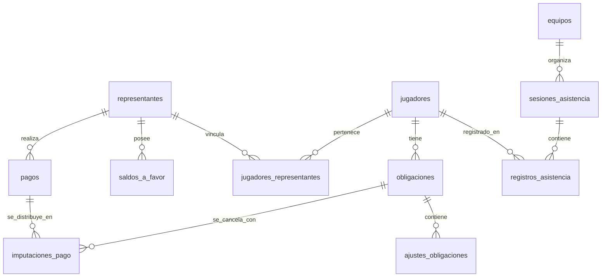

# Especificación Funcional, Modelo de Datos y Arquitectura de Referencia
## FichApp (Gestor de Academias Deportivas) — Versión 0.3 (Actualizada)

> **Estado:** Documento Maestro Definitivo — Sincronizado con Implementación Real (Sprints 0 y 1 Completados)  
> **Academia Piloto:** Obelisco FC, Barquisimeto, Venezuela  
> **Producto:** Plataforma SaaS móvil-first para la administración y gestión deportiva de academias  
> **Stack Base:** React Native + Expo SDK 58 en JavaScript puro (FichApp Design System / Offline-First en cancha), PHP 8.5 puro (Arquitectura DTO-Controller-Service-Repository / PSR-4) y PostgreSQL 16+ con esquemas separados (`seguridad` y `negocio`)  
> **Fecha de Actualización:** Noviembre 2026  

---

## 1. Descripción del Producto y Problema

### 1.1. Propósito
**FichApp** es una plataforma SaaS diseñada para centralizar, profesionalizar y automatizar los procesos administrativos, deportivos y de recaudación de academias, clubes y escuelas deportivas en América Latina, iniciando su validación en el ecosistema bimonetario de Venezuela con la academia piloto **Obelisco FC**.

### 1.2. Problema que Resuelve
1. **Caos en la cobranza bimonetaria:** Pagos fraccionados en Bolívares (VES vía Pago Móvil/Transferencia) a tasa oficial BCV mezclados con pagos en efectivo en Dólares (USD).
2. **Pagos familiares no consolidados:** Un representante con 2 o 3 hijos transfiere un solo monto global que la administración tarda horas en conciliar en cuadernos u hojas de cálculo.
3. **Pérdida de trazabilidad en descuentos:** Dificultad para registrar quién pagó dentro de la ventana de pronto-pago (ej. antes del día 15) mediante abonos parciales acumulativos.
4. **Falta de cobertura en campo:** Entrenadores que no pueden pasar asistencia en canchas deportivas debido a mala o nula conectividad celular.
5. **Riesgo de fraude o errores manuales:** Pagos borrados por error, falta de comprobantes y ausencia de pistas de auditoría.

### 1.3. Propuesta de Valor y Principios de Diseño
* **Móvil Prioritario (*Mobile-First*):** Diseñada para su uso directo desde teléfonos Android e iOS para directores y entrenadores, con una UI clara, sobria y rápida (Light Theme estilo Notion/Figma).
* **Integridad Financiera Inmutable:** Ningún movimiento de dinero se borra físicamente (`DELETE` prohibido en `negocio.pagos`); las correcciones se realizan por reversos y notas de ajuste auditadas.
* **Aritmética Decimal Exacta:** Uso estricto de números decimales de coma fija (`NUMERIC` en SQL y `App\Core\DecimalMath` con `bcmath` en PHP) para erradicar errores de redondeo de punto flotante IEEE 754.
* **Aislamiento Multi-Tenant Estricto:** Cada academia opera de forma hermética y aislada mediante `academia_id` en todas las consultas y transacciones.
* **Separación de Esquemas de Base de Datos:** División formal en PostgreSQL entre el esquema `seguridad` (autenticación, usuarios, sesiones, auditoría) y `negocio` (fichas deportivas, familias, cobranzas, asistencia, contabilidad).
* **Cancha *Offline-First*:** El entrenador puede operar sin conexión y registrar asistencia en SQLite local, sincronizando en lote mediante peticiones idempotentes cuando recupere señal.

---

## 2. Actores y Matriz de Permisos (RBAC)

El sistema define 3 roles esenciales para el funcionamiento de la academia:

| Módulo / Capacidad | Superadmin Plataforma | Administrador Academia | Entrenador |
| :--- | :---: | :---: | :---: |
| **Gestión de Academias (Tenants)** | Lectura / Escritura | No visible | No visible |
| **Usuarios y Roles de su Academia** | Lectura / Escritura | Lectura / Escritura | No visible |
| **Fichas de Jugadores y Categorías** | Lectura | Lectura / Escritura | Solo lectura de sus equipos |
| **Asignación de Planteles y Dorsales**| Lectura | Lectura / Escritura | Solo lectura |
| **Asistencia Técnica en Cancha** | Lectura | Lectura / Escritura | Lectura / Escritura (Offline en móvil) |
| **Políticas de Cobranza y Excepciones**| No visible | Lectura / Escritura | No visible |
| **Generación de Obligaciones** | No visible | Lectura / Escritura | No visible |
| **Registro de Pagos e Imputaciones** | No visible | Lectura / Escritura | No visible |
| **Reversos Financieros y Ajustes** | No visible | Lectura / Escritura (Auditado) | No visible |
| **Reportes y Caja Diaria** | No visible | Lectura / Exportación | No visible |

---

## 3. Motor Financiero y Reglas de Negocio (RN)

### RN-01. Moneda de Referencia y Monedas de Pago
Las obligaciones mensuales se originan y tasan en **USD**. Los pagos se aceptan en **USD** (efectivo, Zelle) o **VES** (Pago Móvil, transferencias bancarias nacionales).

### RN-02. Tasa de Conversión Histórica Inmutable
Todo pago en VES se convierte a USD dividiendo el monto recibido entre la tasa BCV registrada para la fecha efectiva del pago:
$$\text{equivalente\_usd} = \frac{\text{monto\_recibido\_ves}}{\text{tasa\_ves\_por\_usd}}$$
La tasa utilizada queda fijada en el registro del pago. Modificaciones futuras o tasas posteriores **nunca alteran retroactivamente** los pagos ya asentados.

### RN-03. Desacoplamiento de Pagos e Imputaciones (Pagos Familiares)
* Un **Pago** representa un movimiento de dinero real entrante reportado por un representante con su referencia y comprobante.
* Un Pago puede generar **1 o varias Imputaciones** hacia obligaciones del mismo u otros jugadores vinculados al mismo representante (ej. cubrir las cuotas de dos hermanos con un único Pago Móvil).
* La suma de las imputaciones más el remanente a favor debe ser estrictamente igual al monto equivalente en USD del pago:
$$\text{pago.equivalente\_usd} = \sum (\text{imputacion.monto\_imputado\_usd}) + \text{saldo\_a\_favor\_generado}$$

### RN-04. Saldo a Favor (Bolsa de Crédito)
Si el monto recibido supera el monto adeudado de las obligaciones seleccionadas, el remanente se acredita automáticamente a una bolsa de `negocio.saldos_a_favor` asociada al representante. Dicho saldo puede ser imputado en obligaciones de meses posteriores.

### RN-05. Política de Mensualidad Ordinaria y Pronto-Pago
Para la academia piloto (Obelisco FC):
* **Monto ordinario base:** US$ 25.00.
* **Monto pronto-pago exigible:** US$ 20.00.
* **Ventana de pronto-pago:** Del día 1 al día 15 del mes correspondiente, inclusive (hasta las 23:59:59 hora local `America/Caracas`).

### RN-06. Condición y Cálculo del Pronto-Pago
1. El beneficio se considera ganado únicamente si la sumatoria de pagos/imputaciones confirmados dentro de la ventana (hasta el día 15) alcanza el monto de pronto-pago ($US\$ 20.00$).
2. Se permiten **abonos fraccionados**; cada abono suma al acumulado dentro de la ventana.
3. Si el acumulado al cierre del día 15 es menor a US$ 20.00, se pierde la condición: la obligación permanece en el valor ordinario ($US\$ 25.00$) y los abonos se restan de ese total.
4. Cuando se completa la meta de pronto-pago, el backend emite un registro en `negocio.ajustes_obligaciones` de tipo `descuento_pronto_pago` por la diferencia ($-US\$ 5.00$), cerrando la deuda en $US\$ 0.00$. El descuento se registra como **ajuste de pasivo**, nunca como dinero ingresado.

### RN-07. Excepciones (Becas, Tarifas Reducidas y Exoneraciones)
* **Tarifa reducida:** Autoriza un monto mensual inferior para un jugador específico. El administrador debe estipular si permite pronto-pago y el monto promocional exacto.
* **Exoneración:** Genera una obligación con monto exigible igual a cero ($0.00$). Mantiene el historial deportivo sin crear ingresos ficticios.

### RN-08. Inmutabilidad y Reversión
Los pagos confirmados no se eliminan físicamente (`DELETE` prohibido). Para corregir un error se ejecuta una **reversión auditable** que marca el pago como `revertido`, cancela sus imputaciones y recalcula inmediatamente el saldo de las obligaciones afectadas. Si la anulación provoca que el total pagado caiga por debajo de la meta de pronto-pago, el descuento previamente otorgado es revocado automáticamente.

### RN-09. Idempotencia Transaccional
Todo registro de pago debe enviar un encabezado o campo `clave_idempotencia` único (UUID generado por el cliente móvil). Si la app reintenta la petición por inestabilidad de red, el backend devolverá la respuesta del pago original sin duplicar el ingreso en caja.

---

## 4. Requisitos Funcionales Detallados

### Módulo: Autenticación y Multi-Tenancy (RF-01)
* **RF-01.1:** Inicio de sesión con identificador/correo y contraseña segura (hash `password_hash` con PASSWORD_DEFAULT / Argon2id / Bcrypt).
* **RF-01.2:** Generación y validación de tokens Bearer criptográficamente seguros en `seguridad.tokens_acceso` con revocación explícita y tiempo de expiración (30 días).
* **RF-01.3:** Contexto automático: Toda petición autenticada vincula el `academia_id` de la sesión. Es imposible manipular un parámetro para consultar datos de otra academia.

### Módulo: Jugadores y Representantes (RF-02)
* **RF-02.1:** Gestión completa de ficha del jugador: datos personales, médicos (grupo sanguíneo, alergias, observaciones), fecha de nacimiento, categoría y estatus (`activo`, `inactivo`, `retirado`).
* **RF-02.2:** Relación N a M entre jugadores y representantes (`negocio.jugadores_representantes`) con marcación de contacto principal y tipo de parentesco (`padre`, `madre`, `representante_legal`, `abuelo`, `tutor`). Reutilización automática de representantes existentes por cédula en familias con múltiples atletas.
* **RF-02.3:** Búsqueda rápida reactiva por nombre, apellido, cédula, equipo o categoría.

### Módulo: Categorías, Equipos y Temporadas (RF-03)
* **RF-03.1:** Estructuración de categorías por edad y modalidad (`fútbol campo`, `fútbol sala`).
* **RF-03.2:** Creación de equipos y asignación de uno o más entrenadores por equipo (`negocio.asignaciones_entrenadores_equipos`).
* **RF-03.3:** Asignación de jugadores a equipos preservando el historial por temporada, con registro de dorsal y posición en cancha (`negocio.asignaciones_jugadores_equipos`).

### Módulo: Asistencia Técnica en Cancha (RF-04 - *Offline-First*)
* **RF-04.1:** El entrenador puede crear sesiones de entrenamiento para sus equipos asignados.
* **RF-04.2:** El entrenador puede marcar a cada jugador como `presente`, `ausente` o `justificado`, agregando notas u observaciones.
* **RF-04.3:** **Operación 100% Offline:** La app móvil permite registrar la sesión y las asistencias sin conexión a internet, guardándolas en SQLite local con UUIDs generados en el dispositivo.
* **RF-04.4:** **Sincronización Idempotente:** Al recuperar señal, la app sincroniza por lote las sesiones pendientes mediante `POST /api/v1/attendance/sync`.

### Módulo: Facturación, Pagos e Imputaciones (RF-05)
* **RF-05.1:** Generación masiva o individual de obligaciones para un período (mes). El proceso es idempotente: no duplica obligaciones existentes para el mismo concepto y período.
* **RF-05.2:** Registro de pagos en USD o VES vinculados al representante o jugador.
* **RF-05.3:** Imputación flexible: Distribución de un pago entre 1 o múltiples obligaciones pendientes de la familia.
* **RF-05.4:** Aplicación automática o manual de `saldo_a_favor` preexistente.
* **RF-05.5:** Historial y reversión auditable con motivo y usuario responsable.

### Módulo: Tasas de Cambio y Gastos (RF-06)
* **RF-06.1:** Registro de tasa oficial BCV con fecha de vigencia y fuente.
* **RF-06.2:** Registro de egresos y gastos operativos de la academia clasificados por categoría (`arbitraje`, `cancha`, `material_deportivo`, `salarios`, `logistica`, `otro`).
* **RF-06.3:** Reportes de balance de caja, recaudación efectiva y morosidad.

---

## 5. Diseño Físico de Base de Datos (PostgreSQL 16+)

Esquema de datos normalizado con partición formal en dos esquemas (`seguridad` y `negocio`), tipos nativos de alta precisión, restricciones `CHECK`, índices compuestos y UUIDs como claves primarias:

```sql
-- Extensión para generación de UUIDs
CREATE EXTENSION IF NOT EXISTS "uuid-ossp";

-- Creación de esquemas oficiales
CREATE SCHEMA IF NOT EXISTS seguridad;
CREATE SCHEMA IF NOT EXISTS negocio;

-- ============================================================================
-- ESQUEMA: SEGURIDAD (Tenants, Usuarios, Sesiones y Auditoría)
-- ============================================================================

CREATE TABLE seguridad.academias (
    id UUID PRIMARY KEY DEFAULT uuid_generate_v4(),
    nombre VARCHAR(150) NOT NULL,
    rif VARCHAR(30) NULL,
    telefono VARCHAR(30) NULL,
    correo VARCHAR(150) NULL,
    estado VARCHAR(20) NOT NULL DEFAULT 'activo' CHECK (estado IN ('activo', 'suspendido', 'inactivo')),
    zona_horaria VARCHAR(50) NOT NULL DEFAULT 'America/Caracas',
    configuracion JSONB NOT NULL DEFAULT '{}'::jsonb,
    creado_en TIMESTAMPTZ NOT NULL DEFAULT CURRENT_TIMESTAMP,
    actualizado_en TIMESTAMPTZ NOT NULL DEFAULT CURRENT_TIMESTAMP
);

CREATE TABLE seguridad.usuarios (
    id UUID PRIMARY KEY DEFAULT uuid_generate_v4(),
    academia_id UUID NOT NULL REFERENCES seguridad.academias(id) ON DELETE RESTRICT,
    nombre VARCHAR(150) NOT NULL,
    identificador_acceso VARCHAR(100) NOT NULL,
    correo VARCHAR(150) NULL,
    telefono VARCHAR(30) NULL,
    contrasena_hash VARCHAR(255) NOT NULL,
    rol VARCHAR(30) NOT NULL CHECK (rol IN ('superadmin', 'administrador', 'entrenador')),
    estado VARCHAR(20) NOT NULL DEFAULT 'activo' CHECK (estado IN ('activo', 'inactivo')),
    creado_en TIMESTAMPTZ NOT NULL DEFAULT CURRENT_TIMESTAMP,
    actualizado_en TIMESTAMPTZ NOT NULL DEFAULT CURRENT_TIMESTAMP,
    CONSTRAINT uq_usuario_acceso_academia UNIQUE (academia_id, identificador_acceso)
);

CREATE TABLE seguridad.tokens_acceso (
    id UUID PRIMARY KEY DEFAULT uuid_generate_v4(),
    usuario_id UUID NOT NULL REFERENCES seguridad.usuarios(id) ON DELETE CASCADE,
    token_hash VARCHAR(64) NOT NULL UNIQUE,
    expira_en TIMESTAMPTZ NOT NULL,
    ultimo_uso_en TIMESTAMPTZ NULL,
    creado_en TIMESTAMPTZ NOT NULL DEFAULT CURRENT_TIMESTAMP,
    revocado_en TIMESTAMPTZ NULL
);
CREATE INDEX idx_tokens_hash ON seguridad.tokens_acceso(token_hash);

CREATE TABLE seguridad.auditoria (
    id UUID PRIMARY KEY DEFAULT uuid_generate_v4(),
    academia_id UUID NOT NULL REFERENCES seguridad.academias(id) ON DELETE RESTRICT,
    usuario_id UUID NULL REFERENCES seguridad.usuarios(id) ON DELETE SET NULL,
    accion VARCHAR(100) NOT NULL,
    tipo_entidad VARCHAR(50) NOT NULL,
    entidad_id UUID NOT NULL,
    datos_anteriores JSONB NULL,
    datos_nuevos JSONB NULL,
    direccion_ip VARCHAR(45) NULL,
    user_agent TEXT NULL,
    creado_en TIMESTAMPTZ NOT NULL DEFAULT CURRENT_TIMESTAMP
);
CREATE INDEX idx_auditoria_entidad ON seguridad.auditoria(academia_id, tipo_entidad, entidad_id);

-- ============================================================================
-- ESQUEMA: NEGOCIO — ESTRUCTURA DEPORTIVA, ATLETAS Y FAMILIAS
-- ============================================================================

CREATE TABLE negocio.categorias (
    id UUID PRIMARY KEY DEFAULT uuid_generate_v4(),
    academia_id UUID NOT NULL REFERENCES seguridad.academias(id) ON DELETE RESTRICT,
    nombre VARCHAR(100) NOT NULL,
    modalidad VARCHAR(50) NOT NULL DEFAULT 'fútbol campo',
    edad_minima SMALLINT NULL,
    edad_maxima SMALLINT NULL,
    estado VARCHAR(20) NOT NULL DEFAULT 'activo' CHECK (estado IN ('activo', 'inactivo')),
    creado_en TIMESTAMPTZ NOT NULL DEFAULT CURRENT_TIMESTAMP,
    actualizado_en TIMESTAMPTZ NOT NULL DEFAULT CURRENT_TIMESTAMP,
    CONSTRAINT uq_categoria_academia_nombre UNIQUE (academia_id, nombre)
);

CREATE TABLE negocio.equipos (
    id UUID PRIMARY KEY DEFAULT uuid_generate_v4(),
    academia_id UUID NOT NULL REFERENCES seguridad.academias(id) ON DELETE RESTRICT,
    categoria_id UUID NOT NULL REFERENCES negocio.categorias(id) ON DELETE RESTRICT,
    nombre VARCHAR(100) NOT NULL,
    estado VARCHAR(20) NOT NULL DEFAULT 'activo' CHECK (estado IN ('activo', 'inactivo')),
    creado_en TIMESTAMPTZ NOT NULL DEFAULT CURRENT_TIMESTAMP,
    actualizado_en TIMESTAMPTZ NOT NULL DEFAULT CURRENT_TIMESTAMP,
    CONSTRAINT uq_equipo_academia_categoria_nombre UNIQUE (academia_id, categoria_id, nombre)
);

CREATE TABLE negocio.representantes (
    id UUID PRIMARY KEY DEFAULT uuid_generate_v4(),
    academia_id UUID NOT NULL REFERENCES seguridad.academias(id) ON DELETE RESTRICT,
    nombres VARCHAR(100) NOT NULL,
    apellidos VARCHAR(100) NOT NULL,
    cedula VARCHAR(30) NULL,
    telefono VARCHAR(30) NOT NULL,
    correo VARCHAR(150) NULL,
    direccion TEXT NULL,
    creado_en TIMESTAMPTZ NOT NULL DEFAULT CURRENT_TIMESTAMP,
    actualizado_en TIMESTAMPTZ NOT NULL DEFAULT CURRENT_TIMESTAMP
);
CREATE INDEX idx_representantes_busqueda ON negocio.representantes(academia_id, cedula);

CREATE TABLE negocio.jugadores (
    id UUID PRIMARY KEY DEFAULT uuid_generate_v4(),
    academia_id UUID NOT NULL REFERENCES seguridad.academias(id) ON DELETE RESTRICT,
    nombres VARCHAR(100) NOT NULL,
    apellidos VARCHAR(100) NOT NULL,
    fecha_nacimiento DATE NULL,
    cedula VARCHAR(30) NULL,
    sexo CHAR(1) NULL CHECK (sexo IN ('M', 'F')),
    ficha_medica JSONB NOT NULL DEFAULT '{}'::jsonb,
    estado VARCHAR(20) NOT NULL DEFAULT 'activo' CHECK (estado IN ('activo', 'inactivo', 'retirado')),
    creado_en TIMESTAMPTZ NOT NULL DEFAULT CURRENT_TIMESTAMP,
    actualizado_en TIMESTAMPTZ NOT NULL DEFAULT CURRENT_TIMESTAMP,
    eliminado_en TIMESTAMPTZ NULL
);
CREATE INDEX idx_jugadores_busqueda ON negocio.jugadores(academia_id, apellidos, nombres);

CREATE TABLE negocio.jugadores_representantes (
    id UUID PRIMARY KEY DEFAULT uuid_generate_v4(),
    academia_id UUID NOT NULL REFERENCES seguridad.academias(id) ON DELETE RESTRICT,
    jugador_id UUID NOT NULL REFERENCES negocio.jugadores(id) ON DELETE CASCADE,
    representante_id UUID NOT NULL REFERENCES negocio.representantes(id) ON DELETE RESTRICT,
    tipo_relacion VARCHAR(50) NOT NULL DEFAULT 'representante_legal',
    es_contacto_principal BOOLEAN NOT NULL DEFAULT FALSE,
    creado_en TIMESTAMPTZ NOT NULL DEFAULT CURRENT_TIMESTAMP,
    CONSTRAINT uq_jugador_rep_academia UNIQUE (academia_id, jugador_id, representante_id)
);

CREATE TABLE negocio.asignaciones_jugadores_equipos (
    id UUID PRIMARY KEY DEFAULT uuid_generate_v4(),
    academia_id UUID NOT NULL REFERENCES seguridad.academias(id) ON DELETE RESTRICT,
    jugador_id UUID NOT NULL REFERENCES negocio.jugadores(id) ON DELETE CASCADE,
    equipo_id UUID NOT NULL REFERENCES negocio.equipos(id) ON DELETE RESTRICT,
    temporada VARCHAR(50) NOT NULL DEFAULT '2026',
    numero_camiseta SMALLINT NULL,
    posicion VARCHAR(50) NULL,
    vigente_desde DATE NOT NULL DEFAULT CURRENT_DATE,
    vigente_hasta DATE NULL,
    creado_en TIMESTAMPTZ NOT NULL DEFAULT CURRENT_TIMESTAMP
);

CREATE TABLE negocio.asignaciones_entrenadores_equipos (
    id UUID PRIMARY KEY DEFAULT uuid_generate_v4(),
    academia_id UUID NOT NULL REFERENCES seguridad.academias(id) ON DELETE RESTRICT,
    entrenador_id UUID NOT NULL REFERENCES seguridad.usuarios(id) ON DELETE RESTRICT,
    equipo_id UUID NOT NULL REFERENCES negocio.equipos(id) ON DELETE RESTRICT,
    rol_cuerpo_tecnico VARCHAR(50) NOT NULL DEFAULT 'primer_entrenador',
    vigente_desde DATE NOT NULL DEFAULT CURRENT_DATE,
    vigente_hasta DATE NULL,
    creado_en TIMESTAMPTZ NOT NULL DEFAULT CURRENT_TIMESTAMP,
    CONSTRAINT uq_entrenador_equipo_vigente UNIQUE (academia_id, entrenador_id, equipo_id, vigente_desde)
);

CREATE TABLE negocio.saldos_a_favor (
    id UUID PRIMARY KEY DEFAULT uuid_generate_v4(),
    academia_id UUID NOT NULL REFERENCES seguridad.academias(id) ON DELETE RESTRICT,
    representante_id UUID NOT NULL REFERENCES negocio.representantes(id) ON DELETE RESTRICT,
    monto_disponible_usd NUMERIC(12,2) NOT NULL DEFAULT 0.00 CHECK (monto_disponible_usd >= 0),
    actualizado_en TIMESTAMPTZ NOT NULL DEFAULT CURRENT_TIMESTAMP,
    CONSTRAINT uq_saldo_favor_rep UNIQUE (academia_id, representante_id)
);

-- ============================================================================
-- ESQUEMA: NEGOCIO — ASISTENCIA EN CANCHA (OFFLINE COMPATIBLE)
-- ============================================================================

CREATE TABLE negocio.sesiones_asistencia (
    id UUID PRIMARY KEY, -- Generado en el dispositivo móvil
    academia_id UUID NOT NULL REFERENCES seguridad.academias(id) ON DELETE RESTRICT,
    equipo_id UUID NOT NULL REFERENCES negocio.equipos(id) ON DELETE RESTRICT,
    fecha_sesion TIMESTAMPTZ NOT NULL,
    lugar VARCHAR(150) NULL,
    observaciones TEXT NULL,
    creado_por UUID NOT NULL REFERENCES seguridad.usuarios(id),
    sincronizado_en TIMESTAMPTZ NOT NULL DEFAULT CURRENT_TIMESTAMP
);
CREATE INDEX idx_sesiones_equipo_fecha ON negocio.sesiones_asistencia(academia_id, equipo_id, fecha_sesion DESC);

CREATE TABLE negocio.registros_asistencia (
    id UUID PRIMARY KEY, -- Generado en el dispositivo móvil
    academia_id UUID NOT NULL REFERENCES seguridad.academias(id) ON DELETE RESTRICT,
    sesion_id UUID NOT NULL REFERENCES negocio.sesiones_asistencia(id) ON DELETE CASCADE,
    jugador_id UUID NOT NULL REFERENCES negocio.jugadores(id) ON DELETE RESTRICT,
    estado_asistencia VARCHAR(20) NOT NULL CHECK (estado_asistencia IN ('presente', 'ausente', 'justificado')),
    observaciones TEXT NULL,
    creado_en TIMESTAMPTZ NOT NULL DEFAULT CURRENT_TIMESTAMP,
    CONSTRAINT uq_asistencia_jugador_sesion UNIQUE (sesion_id, jugador_id)
);

-- ============================================================================
-- ESQUEMA: NEGOCIO — POLÍTICAS DE COBRANZA Y OBLIGACIONES
-- ============================================================================

CREATE TABLE negocio.politicas_cobranza (
    id UUID PRIMARY KEY DEFAULT uuid_generate_v4(),
    academia_id UUID NOT NULL REFERENCES seguridad.academias(id) ON DELETE RESTRICT,
    monto_ordinario_usd NUMERIC(12,2) NOT NULL DEFAULT 25.00,
    monto_pronto_pago_usd NUMERIC(12,2) NOT NULL DEFAULT 20.00,
    dia_limite_pronto_pago SMALLINT NOT NULL DEFAULT 15,
    dia_vencimiento_ordinario SMALLINT NOT NULL DEFAULT 28,
    vigente_desde DATE NOT NULL,
    vigente_hasta DATE NULL,
    creado_por UUID NOT NULL REFERENCES seguridad.usuarios(id),
    creado_en TIMESTAMPTZ NOT NULL DEFAULT CURRENT_TIMESTAMP
);

CREATE TABLE negocio.excepciones_cobro_jugadores (
    id UUID PRIMARY KEY DEFAULT uuid_generate_v4(),
    academia_id UUID NOT NULL REFERENCES seguridad.academias(id) ON DELETE RESTRICT,
    jugador_id UUID NOT NULL REFERENCES negocio.jugadores(id) ON DELETE RESTRICT,
    tipo_excepcion VARCHAR(30) NOT NULL CHECK (tipo_excepcion IN ('tarifa_reducida', 'exoneracion')),
    monto_mensual_usd NUMERIC(12,2) NULL,
    permite_pronto_pago BOOLEAN NOT NULL DEFAULT FALSE,
    monto_pronto_pago_usd NUMERIC(12,2) NULL,
    vigente_desde DATE NOT NULL,
    vigente_hasta DATE NULL,
    motivo TEXT NOT NULL,
    aprobado_por UUID NOT NULL REFERENCES seguridad.usuarios(id),
    creado_en TIMESTAMPTZ NOT NULL DEFAULT CURRENT_TIMESTAMP
);

CREATE TABLE negocio.obligaciones (
    id UUID PRIMARY KEY DEFAULT uuid_generate_v4(),
    academia_id UUID NOT NULL REFERENCES seguridad.academias(id) ON DELETE RESTRICT,
    jugador_id UUID NOT NULL REFERENCES negocio.jugadores(id) ON DELETE RESTRICT,
    concepto VARCHAR(50) NOT NULL DEFAULT 'mensualidad',
    periodo_inicio DATE NOT NULL,
    periodo_fin DATE NOT NULL,
    fecha_vencimiento DATE NULL,
    politica_cobranza_id UUID NOT NULL REFERENCES negocio.politicas_cobranza(id),
    excepcion_cobro_id UUID NULL REFERENCES negocio.excepciones_cobro_jugadores(id),
    monto_referencia_usd NUMERIC(12,2) NOT NULL,
    monto_ordinario_usd NUMERIC(12,2) NOT NULL,
    monto_pronto_pago_usd NUMERIC(12,2) NULL,
    fecha_limite_pronto_pago TIMESTAMPTZ NULL,
    estado_pronto_pago VARCHAR(20) NOT NULL DEFAULT 'disponible' 
        CHECK (estado_pronto_pago IN ('disponible', 'conseguido', 'vencido', 'no_aplica')),
    estado VARCHAR(20) NOT NULL DEFAULT 'pendiente' 
        CHECK (estado IN ('pendiente', 'parcial', 'pagada', 'vencida', 'exonerada')),
    creado_en TIMESTAMPTZ NOT NULL DEFAULT CURRENT_TIMESTAMP,
    actualizado_en TIMESTAMPTZ NOT NULL DEFAULT CURRENT_TIMESTAMP,
    CONSTRAINT uq_obligacion_periodo_jugador UNIQUE (academia_id, jugador_id, concepto, periodo_inicio)
);
CREATE INDEX idx_obligaciones_morosidad ON negocio.obligaciones(academia_id, estado, periodo_inicio);

CREATE TABLE negocio.ajustes_obligaciones (
    id UUID PRIMARY KEY DEFAULT uuid_generate_v4(),
    academia_id UUID NOT NULL REFERENCES seguridad.academias(id) ON DELETE RESTRICT,
    obligacion_id UUID NOT NULL REFERENCES negocio.obligaciones(id) ON DELETE RESTRICT,
    tipo_ajuste VARCHAR(40) NOT NULL CHECK (tipo_ajuste IN (
        'descuento_pronto_pago', 'descuento_manual', 'ajuste_exoneracion', 'correccion', 'reversion'
    )),
    monto_usd NUMERIC(12,2) NOT NULL,
    motivo TEXT NOT NULL,
    aprobado_por UUID NULL REFERENCES seguridad.usuarios(id),
    ajuste_revertido_id UUID NULL REFERENCES negocio.ajustes_obligaciones(id),
    creado_en TIMESTAMPTZ NOT NULL DEFAULT CURRENT_TIMESTAMP
);

-- ============================================================================
-- ESQUEMA: NEGOCIO — TASAS, PAGOS DESACOPLADOS E IMPUTACIONES
-- ============================================================================

CREATE TABLE negocio.tasas_cambio (
    id UUID PRIMARY KEY DEFAULT uuid_generate_v4(),
    academia_id UUID NULL REFERENCES seguridad.academias(id) ON DELETE CASCADE,
    moneda_base CHAR(3) NOT NULL DEFAULT 'USD',
    moneda_cotizada CHAR(3) NOT NULL DEFAULT 'VES',
    valor_tasa NUMERIC(18,8) NOT NULL CHECK (valor_tasa > 0),
    vigente_desde TIMESTAMPTZ NOT NULL,
    fuente VARCHAR(50) NOT NULL DEFAULT 'BCV',
    registrado_por UUID NULL REFERENCES seguridad.usuarios(id),
    creado_en TIMESTAMPTZ NOT NULL DEFAULT CURRENT_TIMESTAMP
);
CREATE INDEX idx_tasas_recientes ON negocio.tasas_cambio(moneda_base, moneda_cotizada, vigente_desde DESC);

CREATE TABLE negocio.pagos (
    id UUID PRIMARY KEY DEFAULT uuid_generate_v4(),
    academia_id UUID NOT NULL REFERENCES seguridad.academias(id) ON DELETE RESTRICT,
    representante_id UUID NOT NULL REFERENCES negocio.representantes(id) ON DELETE RESTRICT,
    monto_recibido NUMERIC(18,2) NOT NULL CHECK (monto_recibido > 0),
    moneda_recibida CHAR(3) NOT NULL CHECK (moneda_recibida IN ('USD', 'VES')),
    equivalente_usd NUMERIC(12,2) NOT NULL CHECK (equivalente_usd > 0),
    tasa_cambio_id UUID NULL REFERENCES negocio.tasas_cambio(id),
    valor_tasa_aplicada NUMERIC(18,8) NULL,
    metodo_pago VARCHAR(50) NOT NULL CHECK (metodo_pago IN (
        'pago_movil', 'efectivo_usd', 'efectivo_ves', 'transferencia_bancaria', 'zelle', 'saldo_a_favor'
    )),
    referencia VARCHAR(100) NULL,
    comprobante_url VARCHAR(255) NULL,
    fecha_recepcion TIMESTAMPTZ NOT NULL,
    fecha_registro TIMESTAMPTZ NOT NULL DEFAULT CURRENT_TIMESTAMP,
    registrado_por UUID NOT NULL REFERENCES seguridad.usuarios(id),
    estado VARCHAR(20) NOT NULL DEFAULT 'confirmado' CHECK (estado IN ('confirmado', 'revertido')),
    clave_idempotencia VARCHAR(100) NOT NULL UNIQUE,
    fecha_reversion TIMESTAMPTZ NULL,
    revertido_por UUID NULL REFERENCES seguridad.usuarios(id),
    motivo_reversion TEXT NULL,
    creado_en TIMESTAMPTZ NOT NULL DEFAULT CURRENT_TIMESTAMP
);
CREATE INDEX idx_pagos_representante ON negocio.pagos(academia_id, representante_id, fecha_recepcion DESC);

CREATE TABLE negocio.imputaciones_pago (
    id UUID PRIMARY KEY DEFAULT uuid_generate_v4(),
    academia_id UUID NOT NULL REFERENCES seguridad.academias(id) ON DELETE RESTRICT,
    pago_id UUID NOT NULL REFERENCES negocio.pagos(id) ON DELETE RESTRICT,
    obligacion_id UUID NOT NULL REFERENCES negocio.obligaciones(id) ON DELETE RESTRICT,
    monto_imputado_usd NUMERIC(12,2) NOT NULL CHECK (monto_imputado_usd > 0),
    estado VARCHAR(20) NOT NULL DEFAULT 'activo' CHECK (estado IN ('activo', 'revertido')),
    creado_en TIMESTAMPTZ NOT NULL DEFAULT CURRENT_TIMESTAMP,
    CONSTRAINT uq_pago_obligacion_activa UNIQUE (pago_id, obligacion_id)
);
CREATE INDEX idx_imputaciones_obligacion ON negocio.imputaciones_pago(obligacion_id, estado);

CREATE TABLE negocio.gastos (
    id UUID PRIMARY KEY DEFAULT uuid_generate_v4(),
    academia_id UUID NOT NULL REFERENCES seguridad.academias(id) ON DELETE RESTRICT,
    concepto VARCHAR(150) NOT NULL,
    categoria_gasto VARCHAR(50) NOT NULL CHECK (categoria_gasto IN (
        'arbitraje', 'cancha', 'material_deportivo', 'salarios', 'logistica', 'otro'
    )),
    monto NUMERIC(18,2) NOT NULL CHECK (monto > 0),
    moneda CHAR(3) NOT NULL CHECK (moneda IN ('USD', 'VES')),
    equivalente_usd NUMERIC(12,2) NULL,
    tasa_cambio_id UUID NULL REFERENCES negocio.tasas_cambio(id),
    valor_tasa_aplicada NUMERIC(18,8) NULL,
    fecha_gasto DATE NOT NULL,
    referencia VARCHAR(100) NULL,
    registrado_por UUID NOT NULL REFERENCES seguridad.usuarios(id),
    creado_en TIMESTAMPTZ NOT NULL DEFAULT CURRENT_TIMESTAMP
);
```

---

## 6. Diagrama Entidad-Relación de Imputación de Pagos y Asistencia



---

## 7. Arquitectura Backend: PHP 8.5 Puro (Patrón DTO-Controller-Service-Repository)

Inspirado en la simplicidad, robustez y orden de `DIRPOLES-4`, el backend se estructura en capas desacopladas con tipado estricto `declare(strict_types=1);` y el namespace raíz `App\` mapeado a `backend/app/`:

```
backend/
├── composer.json               # Autoloading App\ -> app/ y scripts (migrate, seed, test)
├── public/
│   └── index.php               # Punto de entrada HTTP y despacho de Router
├── migrations/                 # Migraciones SQL versionadas para PostgreSQL
│   ├── 001_crear_tablas_base_tenants_usuarios.sql
│   └── 002_crear_tablas_deportivas_y_familias.sql
├── scripts/
│   ├── migrate.php             # Ejecutor de migraciones CLI
│   └── seed.php                # Carga de datos piloto Obelisco FC
├── tests/                      # Suite de pruebas automatizadas PHPUnit 11
│   ├── Unit/                   # DecimalMath, Router, DTOs
│   └── Integration/            # Flujos completos con base de datos real
└── app/
    ├── Config/                 # Configuración de base de datos y entorno
    ├── Core/                   # Bloques fundacionales
    │   ├── Database.php        # Conexión PDO estricta y transacciones ACID
    │   ├── DecimalMath.php     # Operaciones exactas con bcmath (add, sub, mul, div, comp)
    │   ├── Env.php             # Parser nativo de variables de entorno .env
    │   ├── ErrorCodes.php      # Diccionario de códigos de error estables
    │   ├── ExcepcionApi.php    # Excepción de dominio con código y estado HTTP
    │   ├── Respuesta.php       # Formateador homogéneo JSON (exito / error)
    │   └── Router.php          # Router HTTP ligero con soporte para middlewares
    ├── DTOs/                   # Clases readonly tipadas de entrada (desdePeticion)
    │   ├── IniciarSesionDTO.php
    │   ├── RegistrarJugadorDTO.php
    │   ├── ActualizarJugadorDTO.php
    │   ├── AsignarEquipoDTO.php
    │   └── CrearRepresentanteDTO.php
    ├── Controllers/            # Controladores delgados con funciones limpias
    │   ├── AuthController.php
    │   ├── JugadorController.php
    │   ├── EstructuraDeportivaController.php
    │   └── FamiliaController.php
    ├── Services/               # Cerebro del negocio, validaciones y orquestación
    │   ├── AuthService.php
    │   ├── JugadorService.php
    │   ├── EstructuraDeportivaService.php
    │   └── FamiliaService.php
    ├── Repositories/           # Consultas SQL preparadas con PDO filtrando por academia_id
    │   ├── UsuarioRepository.php
    │   ├── TokenAccesoRepository.php
    │   ├── AuditoriaRepository.php
    │   ├── JugadorRepository.php
    │   ├── RepresentanteRepository.php
    │   ├── EquipoRepository.php
    │   └── CategoriaRepository.php
    ├── Middlewares/            # Filtros de petición
    │   ├── CorsMiddleware.php
    │   ├── TenantMiddleware.php
    │   └── AuthMiddleware.php
    └── routes/
        └── api.php             # Catálogo de rutas REST bajo /api/v1/
```

### 7.1. Contrato Único de Respuestas HTTP
Toda respuesta de la API responde a un contrato JSON consistente:

**Éxito:**
```json
{
  "exito": true,
  "datos": { ... }
}
```

**Error:**
```json
{
  "exito": false,
  "error": {
    "codigo": "VALIDACION_CAMPOS",
    "mensaje": "Los datos suministrados son inválidos.",
    "detalles": {
      "cedula": "Ya existe un jugador registrado con esta cédula."
    }
  }
}
```

---

## 8. Arquitectura Móvil: React Native + Expo SDK 58 (JavaScript Puro)

El frontend móvil está construido exclusivamente en **JavaScript puro (`.js` / `.jsx`)**, sin TypeScript, bajo Expo SDK 58 (React Native 0.88 + React 19).

```
mobile/
├── App.js                      # Inicialización y AuthProvider
├── app.json                    # Manifiesto oficial Expo SDK 58
├── package.json                # Dependencias aprobadas
├── .antigravity/SKILLS/
│   └── fichapp-design-system/  # Especificación oficial de diseño
└── src/
    ├── config/
    │   └── api.js              # Resolución dinámica de IP LAN (expo-constants) y URL base
    ├── context/
    │   └── AuthContext.js      # Sesión global, token y datos de usuario
    ├── navigation/
    │   └── RootNavigator.js    # Stack condicional por rol (Login, Admin, Coach, Directorio, Ficha)
    ├── screens/
    │   ├── auth/LoginScreen.js
    │   ├── admin/AdminDashboardScreen.js
    │   ├── coach/CoachDashboardScreen.js
    │   └── players/
    │       ├── PlayerDirectoryScreen.js # Directorio, búsqueda y filtro por categoría
    │       ├── PlayerDetailScreen.js    # Ficha técnica, médica, tutores y asignación
    │       └── CreatePlayerScreen.js    # Formulario integral de inscripción
    ├── services/
    │   ├── apiService.js       # Fetch client con timeout (8s) y Bearer injection
    │   └── storage.js          # expo-secure-store para tokens y credenciales
    └── theme/
        ├── tokens.js           # Colores, tipografías, espaciados, radios y sombras
        └── index.js            # Exportación centralizada del tema
```

### 8.1. FichApp Design System
* **Tema:** Claro (*Light Theme*) sobrio, limpio y moderno estilo Notion/Figma.
* **Paleta Oficial:**
  * Fondo: `#F3F6F2` (`surfaceBackground`)
  * Superficies: `#FFFFFF` (`surfaceDefault`)
  * Marca Primario: `#174D50` (`brandPrimary` - Azul Petróleo)
  * Marca Acento: `#B9E44A` (`brandAccent` - Verde Lima)
  * Texto Primario: `#252B27` (`textPrimary`)
  * Texto Secundario: `#5A655E` (`textSecondary`)
* **Iconografía:** Prohibido el uso de emojis como iconos de interfaz. Uso obligatorio y exclusivo de `lucide-react-native` y `react-native-svg`.
* **Áreas Seguras:** Uso obligatorio de `react-native-safe-area-context` (`SafeAreaView` / `useSafeAreaInsets`). Prohibido el componente deprecado de React Native.

### 8.2. Flujo Offline-First en Cancha (SQLite)
```
       FLUJO DE ASISTENCIA EN CANCHA (COACH APP)

  [ Entrenador en Cancha ]
            │
            ▼
  [ Pasa Asistencia ] ──> [ SQLite Local (Expo SQLite) ]
                                  │
                       ¿Conexión a Internet?
                                 / \
                                /   \
                             SÍ      NO
                             /         \
                            /           ▼
                           /     [ Estado 'pending' ]
                          /      [ Queda en Cola ]
                         ▼              │
                 [ Sincroniza ] <───────┘ (Al volver a tener señal)
                         │
                         ▼
        POST /api/v1/attendance/sync
```

---

## 9. Catálogo de Rutas REST v1 de la API

Todos los endpoints exigen autenticación por token `Bearer` (salvo `/auth/login`) y resuelven el `academia_id` automáticamente en el middleware de contexto.

| Método | Endpoint | Descripción | Idempotencia |
| :--- | :--- | :--- | :---: |
| `POST` | `/api/v1/auth/login` | Autenticación con identificador y contraseña | No |
| `GET`  | `/api/v1/auth/me` | Datos del usuario actual, academia y permisos | No |
| `POST` | `/api/v1/auth/logout` | Revocación inmediata del token de acceso | No |
| `GET`  | `/api/v1/categories` | Lista de categorías de la academia | No |
| `POST` | `/api/v1/categories` | Creación de nueva categoría deportiva | No |
| `GET`  | `/api/v1/teams` | Lista de equipos y categorías asignadas | No |
| `POST` | `/api/v1/teams` | Creación de equipo en una categoría | No |
| `GET`  | `/api/v1/players` | Directorio con búsqueda y filtro por categoría/equipo | No |
| `POST` | `/api/v1/players` | **Inscripción integral de jugador, representante y equipo** | No |
| `GET`  | `/api/v1/players/{id}` | Ficha completa (personal, médica, tutores, historial) | No |
| `PUT`  | `/api/v1/players/{id}` | Actualización de datos del jugador | No |
| `DELETE`| `/api/v1/players/{id}` | Baja lógica del atleta (`retirado`) | No |
| `POST` | `/api/v1/players/{id}/team` | **Asignación o cambio de equipo, dorsal y posición** | No |
| `GET`  | `/api/v1/representatives` | Directorio de tutores legales | No |
| `POST` | `/api/v1/representatives` | Registro manual de representante | No |
| `GET`  | `/api/v1/representatives/{id}/family` | Hijos y obligaciones activas de la familia | No |
| `POST` | `/api/v1/obligations/generate` | Generación mensual masiva de obligaciones | Sí |
| `GET`  | `/api/v1/obligations` | Consulta de saldos y morosidad | No |
| `POST` | `/api/v1/payments` | **Registro de Pago e Imputación Familiar** | **Sí (Header)** |
| `POST` | `/api/v1/payments/{id}/reverse` | Reverso de pago y anulación de imputaciones | Sí |
| `POST` | `/api/v1/attendance/sync` | **Sincronización de asistencia offline** | **Sí** |
| `GET`  | `/api/v1/exchange-rates/latest`| Consulta de tasa BCV vigente | No |
| `POST` | `/api/v1/exchange-rates` | Carga manual o actualización de tasa | No |
| `GET`  | `/api/v1/reports/daily-cash` | Cuadre diario de caja por moneda (VES / USD) | No |

---

## 10. Matriz de Casos de Prueba Críticos (Testing Matrix)

Antes del pase a producción en Obelisco FC, el módulo financiero y deportivo debe superar el 100% de los siguientes casos de prueba automatizados:

1. **Pronto-Pago Fraccionado Exitoso:**
   - Obligación de $25 (Pronto-pago $20 hasta el 15).
   - Abono 1 (día 5): $10 equivalentes. Abono 2 (día 14): $10 equivalentes.
   - *Resultado esperado:* El día 14 se genera automáticamente el ajuste de descuento por -$5 y la obligación queda en estado `pagada` con saldo $0.00.
2. **Pronto-Pago Perdido por Vencimiento:**
   - Abono 1 (día 5): $10 equivalentes. Abono 2 (día 16): $10 equivalentes.
   - *Resultado esperado:* No se genera descuento de pronto-pago. Saldo restante: $5. Estado: `parcial`.
3. **Pago Familiar Multihijo:**
   - Representante con Hijo A (debe $20) e Hijo B (debe $20).
   - Pago Móvil por 2,100 VES (tasa 52.50 = $40.00 USD). Se imputan $20 a Hijo A y $20 a Hijo B.
   - *Resultado esperado:* Un solo registro en `negocio.pagos`, dos registros en `negocio.imputaciones_pago`. Ambas obligaciones saldadas.
4. **Pago con Exceso (Saldo a Favor):**
   - Cuota de $20. Pago recibido por $25 equivalentes.
   - *Resultado esperado:* Obligación `pagada`. La tabla `negocio.saldos_a_favor` del representante refleja $5.00 disponibles para el mes siguiente.
5. **Reversión de Pago y Descuento:**
   - Obligación ganada por pronto-pago ($20 pagados, $5 descontados). Se detecta error en la referencia y se revierte el pago de $20.
   - *Resultado esperado:* Pago en estado `revertido`, imputación revertida, descuento de pronto-pago revocado (con marca de reversión). Obligación vuelve a estado `pendiente` con deuda de $25.
6. **Asistencia Offline con Duplicidad:**
   - Entrenador pasa asistencia sin conexión. Reintenta la sincronización 2 veces al conectarse.
   - *Resultado esperado:* Restricción de unicidad en PostgreSQL garantiza que solo exista 1 registro por jugador y sesión, sin duplicación.
